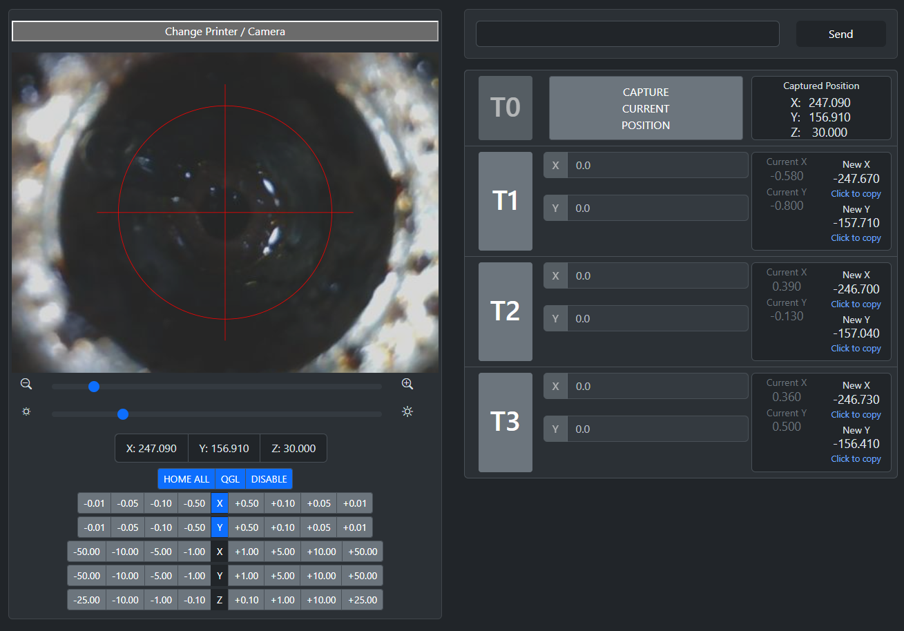
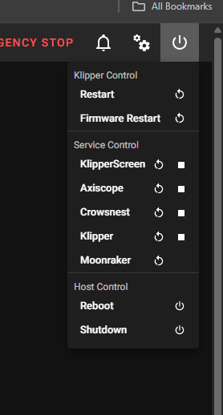
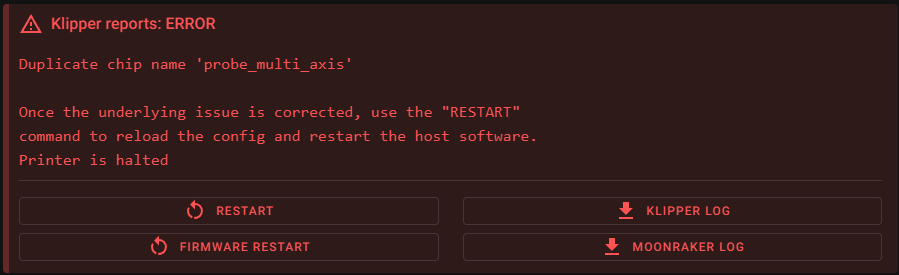

# Axiscope

## What is Axiscope?

Axiscope is a specialized tool designed to simplify the XY calibration process for multi-tool 3D printers running Klipper Tool Changer Plugin using camera-assisted alignment. It provides a streamlined interface for:

- Manual XY calibration using camera feedback
- Quick and precise T0 - Tn alignment
- No calculation required, It just does its magic and tell you the offset.

<br/>
<br/>

## Hardware Requirements

### Camera Options

#### DIY Option
The following parts are required if you want to build the camera yourself:

- [\[XY Nozzle Alignment Camera\]](https://www.printables.com/model/1099576-xy-nozzle-alignment-camera) - 3D printed parts
- OV9726 camera module
- 5V 3mm round white6000-6500k LEDS x 4

#### Pre-assembled Option
A fully assembled camera with long USB cable can be purchased from:
- [Ember Prototypes](https://www.emberprototypes.com/products/cxc)

### Z Calibration Requirements (Optional)

If you want to use automatic Z calibration:
- An endstop switch mounted at a known position
- Configuration added to your printer.cfg (see Configuration section)


## Installation

**Requirements:**

- Klipper installed and running
- [Klipper Tool Changer](https://github.com/viesturz/klipper-toolchanger)
- Moonraker configured
- Camera setup in Crowsnest & Mainsail
- SSH access to your printer


Quick installation using curl:

```bash
curl -sSL https://raw.githubusercontent.com/nic335/Axiscope/refs/heads/main/install.sh | bash
```

The install script will:

- Create Python virtual environment
- Install required dependencies
- Set up the systemd service
- Configure Moonraker integration

### Starting Axiscope

1. Open your Mainsail interface
2. Find 'axiscope' in the services list under "Klipper/Service/Host Control"
3. Use the Start/Stop button to control the service

<br/>

## Configuration

If you want to use automatic Z calibration, add the following to your `printer.cfg`:

```ini
[axiscope]
pin: !PG15                # Endstop pin
zswitch_x_pos: 226.71     # REQUIRED - X position of the endstop switch
zswitch_y_pos: -18.46     # REQUIRED - Y position of the endstop switch
zswitch_z_pos: 7.8        # REQUIRED - Z position + some clearance of the endstop switch
lift_z: 1                 # OPTIONAL - Amount to lift Z before moving (default: 1)
move_speed: 60            # OPTIONAL - XY movement speed in mm/s (default: 60)
config_file_path: ~/printer_data/config/axiscope.offsets  # OPTIONAL - file "Save to config file" writes tool offsets to (must be [include]d in printer.cfg, or point it at printer.cfg)
z_move_speed: 10          # OPTIONAL - Z movement speed in mm/s (default: 10)
start_gcode: 
  
  
      M104 T{tool} S150
  
before_pickup_gcode: M118 pickup_gcode
after_pickup_gcode: M118 after_pickup_gcode
                    # NOZZLE_SCRUBBER_W
finish_gcode: M118 Calibration complete
  
  
      M104 T{tool} S0
  
  T0

```

### Finding the Endstop Position

To correctly configure the endstop position for Z calibration:

1. Home your printer with T0 selected
2. Using the jog controls in your printer interface, carefully position the nozzle directly centered over the endstop pin
3. Note the current X, Y, and Z positions displayed in your interface
4. Use these values for `zswitch_x_pos` and `zswitch_y_pos` in your configuration
5. For `zswitch_z_pos`, add 3mm to your current Z position (If using multiple hotends of varying lengths, add additional clearance as needed.)

Example: If your position readings are X:226.71, Y:-18.46, Z:4.8, then configure:
```
zswitch_x_pos: 226.71
zswitch_y_pos: -18.46
zswitch_z_pos: 7.8  # 4.8 + 3mm clearance
```

### G-code Macro Options

Axiscope now supports templated G-code macros with full Jinja template support.

- **start_gcode**: Executed at the beginning of calibration
- **before_pickup_gcode**: Executed before each tool change
- **after_pickup_gcode**: Executed after each tool change
- **finish_gcode**: Executed after calibration is complete


If you plan on using hostname to connect to your printer, For example voron.local:3000, you will need to add the following to your moonraker.conf: `*.local:*`
this should look like this

```ini
[authorization]
trusted_clients:
    192.168.0.0/16
    10.0.0.0/8
    127.0.0.0/8
    169.254.0.0/16
    172.16.0.0/12
    192.168.0.0/16
    FE80::/10
    ::1/128
cors_domains:
    *.lan
    *.local
    *.local:*
    *://localhost
    *://localhost:*
    *://my.mainsail.xyz
    *://app.fluidd.xyz
```


## Usage Guide

### Initial Setup

1. Open `http://your-printer-ip:3000`. Axiscope looks for Moonraker on the same host (port 80 or 7125) and connects on its own. If it can't find it, enter the address under **Setup**.
2. If the printer has more than one camera, select the nozzle camera under **Setup**.

### Calibrating XY offsets

1. On **Calibration**, home the printer and pick up `T0` with the tool buttons.
2. Centre the `T0` nozzle on the crosshair, with **Auto align** or by jogging, then press **Capture reference** (or Enter).
3. Select `Tn`. Axiscope changes tools and moves the new tool to the captured position.
4. Centre `Tn` on the crosshair and press **Capture Tn position**. The new offset appears in **Tool offsets**.
5. Repeat for every tool, then open **Offsets** to review the generated config. Use **Copy config**, or **Save to config file** (this needs `config_file_path`, see below), then run `FIRMWARE_RESTART`.

### Cameras and minicam

**Setup** lists cameras from two sources, so cameras that were never added to Mainsail or Fluidd still appear:

- **Moonraker**: the webcams configured in Mainsail, Fluidd or `moonraker.conf`.
- **crowsnest**: every `[cam ...]` section in `crowsnest.conf`, read through Moonraker. Axiscope first tries the standard nginx path for the camera's port (8080 → `/webcam/`, 8081 → `/webcam2/`, up to 8083), then the streamer port directly (with `no_proxy: true`). Cameras already in Moonraker's list aren't repeated; unreachable ones are dimmed.

WebRTC cameras are shown through their MJPEG endpoints, because the camera view and detection need individual frames:

- **go2rtc** (Mainsail's *WebRTC (go2rtc)* service, usually port 1984): `…/stream.html?src=cam` becomes `…/api/stream.mjpeg?src=cam`, with snapshots from `…/api/frame.jpeg?src=cam`. go2rtc needs ffmpeg for these if the source isn't already MJPEG.
- **camera-streamer** in WebRTC mode: `…/webrtc` becomes `…/stream` and `…/snapshot`.

Press **Rescan** after adding or plugging in a camera; the list also refreshes every 15 seconds while Setup is open.

To use a stream from anywhere else, enter it under **Setup → Add a camera by stream URL**. Both full URLs (`http://192.168.1.50:8081/?action=stream`) and paths on the printer (`/webcam3/?action=stream`) work. The stream must be MJPEG with a matching snapshot URL (`?action=snapshot` or `/snapshot`), because detection works on single frames. Added cameras are remembered per printer and can be removed again.

**Minicam** in the top bar opens a second camera, such as a chamber cam, in a floating window over the page:

- Pick its camera from the dropdown in its header.
- Drag it by the header strip or the video; it snaps to the nearest corner.
- Resize it from the grip on its inner corner, or focus the grip and use the arrow keys (Shift for bigger steps).
- Its camera, corner and size are remembered in the browser. Closing it also stops its stream.

The animations below show the previous interface, but the steps are the same.

<br/>
<br/>
<br/>

### Auto alignment (OpenCV)

Axiscope can find and centre the nozzle for you. Detection and motion run on the Axiscope host (OpenCV, installed by `install.sh`); the browser only shows the result.

1. Home the printer, pick up a tool and move it roughly over the camera (within about a third of the view).
2. In **Circle detection**, switch detection on. Tune *Min / Max radius* until the overlay draws dashed rings on the nozzle (orifice and tip face). *Show edge map* under *Advanced tuning* helps with the Canny and blur settings.
3. Press **Auto align** (or the crosshair button in the middle of the jog pad). Axiscope then:
   - **Scan**: Canny edge detection, then a search for concentric circles; the centre comes from a joint fit of all rings.
   - **Probe**: moves 0.5 mm in X and then in Y and compares the images to learn the camera scale, rotation and mirroring. No camera orientation setup is needed.
   - **Correct and repeat**: moves the nozzle onto the crosshair, re-scans and corrects again until it is within tolerance, at most *N* times.
4. Check the camera view and confirm with **Accept & capture**, or use **Revert move** or **Run again**. Nothing is captured without your confirmation.

**Camera mounted sideways or mirrored?** Press **Check orientation**. Axiscope moves 0.5 mm in X and in Y, watches where the nozzle goes in the image, moves back and checks it returns to the same pixel. It reports the result in plain terms ("+X moves the image down, +Y moves it right") and turns the camera view so +X points right and +Y up on screen, which makes the jog arrows match the picture. This only changes the display; detection and alignment always use the raw frame, so they work with any camera orientation. **Rotate** and **Flip H/V** under the camera adjust the view by hand.

If a run behaves oddly, press **Copy log** in the result panel and include it in a bug report; it lists every measurement, the learned mapping and the settings.

Iterations, tolerance, probe distance, safety limit, settle time and speed are under **Setup → Auto alignment**. Turn on *Reuse camera calibration* to skip the probe moves for the 2nd and later tools.

Existing installs: the update manager installs OpenCV automatically if your `[update_manager axiscope]` section has these lines (new installs get them):

```ini
virtualenv: ~/axiscope/axiscope-env
requirements: requirements.txt
```

Otherwise, run `~/axiscope/axiscope-env/bin/pip install numpy opencv-python-headless` once and restart the axiscope service.

### Development without a printer

Install the dependencies once (`pip install -r requirements.txt pytest`), then:

```bash
python tests/mock_moonraker.py   # simulated toolchanger: Moonraker on 7125, cameras on 18080/18081
python app.py                    # Axiscope on http://localhost:3000
```

Opening `http://localhost:3000` connects to the mock by itself. The mock offers three cameras: one listed by Moonraker, one only in its `crowsnest.conf`, and one offline. Its tools have known "true" offsets, and a correct calibration recovers them exactly. Set `CAM_PORT` to move the camera ports if 18080/18081 are taken.

Run the tests with `python -m pytest tests`.

## Troubleshooting And FAQ
### Camera is not shown in Axiscope
Press **Rescan** under **Setup**. Axiscope reads both Moonraker's webcam list and `crowsnest.conf`. If a crowsnest camera shows as *not reachable*, its port has no nginx path and the streamer only listens locally: set `no_proxy: true` for that camera in `crowsnest.conf`, or add its stream with **Add a camera by stream URL**.

The camera needs to be configured and also configured in mainsail
This following links will guide you thru installing and configuring the camera in crowsness and fluid and mainsail

[https://mellow.klipper.cn/en/docs/DebugDoc/BasicTutorial/camera/](https://mellow.klipper.cn/en/docs/DebugDoc/BasicTutorial/camera/)

[Configuring the camera in Mainsail](https://docs.mainsail.xyz/overview/settings/webcams)

### Camera only load if they where plug before rebooting the printer.
Some camera wont be auto-detected by crowsnest automaticaly. You can simply restart crowsnest instead of rebooting the printer.

### Error: Duplicate chip name 'probe_multi_axis'

If you encounter this error when starting Klipper:

<br/>

**Problem:** You likely have both the toolchanger's `calibrate_offsets.cfg` and Axiscope configured in your printer.cfg. Both modules use the same 'probe_multi_axis' chip name.

**Solution:** 
1. Remove or comment out the inclusion of `calibrate_offsets.cfg` in your printer.cfg
2. OR ensure you're only using one of these two calibration methods, not both

Only Axiscope should be using the `probe_multi_axis` module when configured correctly.

## Credits
[Nic335](https://github.com/nic335) and [N3MI-DG](https://github.com/N3MI-DG)

## License
MIT License

Permission is hereby granted, free of charge, to any person obtaining a copy
of this software and associated documentation files (the "Software"), to deal
in the Software without restriction, including without limitation the rights
to use, copy, modify, merge, publish, distribute, sublicense, and/or sell
copies of the Software, and to permit persons to whom the Software is
furnished to do so, subject to the following conditions:

The above copyright notice and this permission notice shall be included in all
copies or substantial portions of the Software.

THE SOFTWARE IS PROVIDED "AS IS", WITHOUT WARRANTY OF ANY KIND, EXPRESS OR
IMPLIED, INCLUDING BUT NOT LIMITED TO THE WARRANTIES OF MERCHANTABILITY,
FITNESS FOR A PARTICULAR PURPOSE AND NONINFRINGEMENT. IN NO EVENT SHALL THE
AUTHORS OR COPYRIGHT HOLDERS BE LIABLE FOR ANY CLAIM, DAMAGES OR OTHER
LIABILITY, WHETHER IN AN ACTION OF CONTRACT, TORT OR OTHERWISE, ARISING FROM,
OUT OF OR IN CONNECTION WITH THE SOFTWARE OR THE USE OR OTHER DEALINGS IN THE
SOFTWARE.
